# Alur Sistem End-to-End

Dokumen ini menelusuri perjalanan satu ulasan dari berkas mentah sampai
menjadi baris rekomendasi, sekaligus memetakan tiap langkah ke tahapan
penelitian pada Bab III.

## 1. Alur menyeluruh

```mermaid
flowchart LR
    A["Berkas mentah<br/>data/raw/reviews.csv"] --> B["01 · Muat data<br/>validasi bentuk"]
    B --> C["02 · Praproses<br/>10 tahap + klausa"]
    C --> D["03 · Muat label<br/>data/reference/labels.csv"]
    D --> E["04 · Latih model<br/>TF-IDF + SVM linear"]
    E --> F["05 · Klasifikasi<br/>aspek + sentimen"]
    F --> G["06 · Modul keputusan<br/>frasa, prioritas, aturan"]
    G --> H["Laporan<br/>CSV · Markdown · SQLite"]
    H --> I["Penyajian<br/>API FastAPI → klien React / CLI"]

    style A fill:#e8eefc
    style I fill:#e6f4ea
```



Waktu tiap tahap dicatat pada `PipelineOutput.timings` dengan kunci
`01_muat_data` … `06_modul_keputusan` dan `total` — inilah bahan KNF-01 dan
KNF-02.

## 2. Perjalanan satu ulasan (contoh nyata)

**Masukan mentah**

| Kolom | Nilai |
|---|---|
| `review_id` | `GM4f21a9c7e0` |
| `text` | `"makanannya enak bgt tapi pelayanannya lama bgt, nunggu 30 menit gk datang2. parkirnya juga susah"` |
| `rating` | `2` |

**Tahap 02 — hasil praproses**

```
text_clean : "makanan enak banget tapi pelayanan lama banget tunggu 30 menit tidak datang datang parkir susah"
clauses    : ["makanan enak banget",
              "pelayanan lama banget tunggu 30 menit tidak datang datang",
              "parkir susah"]
```

Perhatikan dua hal yang disengaja:

- kata `tapi` memotong cakupan negasi, sehingga "makanan enak" tidak ikut
  dianggap negatif;
- klausa ketiga tetap utuh meski tidak ada kata "tidak", karena keluhan dapat
  dinyatakan tanpa negasi eksplisit ("parkirnya susah").

**Tahap 04–05 — keluaran klasifikasi**

| Aspek | Sentimen | Keyakinan |
|---|---|---|
| makanan | positif | 0,91 |
| pelayanan | negatif | 0,96 |
| fasilitas | negatif | 0,88 |

**Tahap 06 — keputusan**

1. *Keparahan*: rating = 2 → `Keparahan = (5 − 2) / 4 = 0,75`.
2. *Frasa*: klausa yang memuat penanda aspek **dan** indikasi keluhan.
   - pelayanan → kandidat dari klausa 2 → `pelayanan lama banget`, `tunggu 30 menit tidak datang datang`
   - fasilitas → kandidat dari klausa 3 → `parkir susah`
3. *Skor prioritas* dihitung atas seluruh ulasan pada jalan itu.

**Keluaran akhir**

```
Peringkat 1  pelayanan   Prioritas 0,812  (volume 0,72 · keparahan 0,78 · keragaman 0,65)
             Frasa dominan : "pelayanan lama banget" (41×), "tunggu lama" (28×)
             Rekomendasi   : tetapkan target waktu penyajian dan tinjau jumlah
                             petugas pada jam sibuk
Peringkat 2  fasilitas   Prioritas 0,634  (volume 0,55 · keparahan 0,61 · keragaman 0,58)
             Frasa dominan : "parkir susah" (37×), "toilet kotor" (22×)
             Rekomendasi   : tambah petunjuk lahan parkir dan jadwalkan
                             pemeriksaan kebersihan berkala
```

## 3. Langkah pada baris perintah

```bash
export PYTHONPATH=src

# 01-06 sekaligus
python -m rra.cli run

# Uji sensitivitas bobot prioritas ±10%
python -m rra.cli sensitivity

# Telusuri praproses satu kalimat
python -m rra.cli explain "makanannya enak bgt tapi pelayanannya lama, parkirnya susah"

# Lihat komponen model yang terdaftar
python -m rra.cli models
```

## 4. Pemetaan langkah ke Bab III

| Langkah sistem | Tahapan penelitian (Bab III) | Luaran yang dilaporkan |
|---|---|---|
| 01 Muat data | Pengumpulan & pembersihan data | jumlah ulasan, periode, sumber |
| 02 Praproses | Perancangan praproses teks Bahasa Indonesia | tabel 10 tahap, contoh sebelum/sesudah |
| 03 Muat label | Anotasi manual dua pemberi label | **nilai Cohen's κ** (aspek & sentimen) |
| 04 Latih model | Implementasi komponen model | Macro-F1 aspek & sentimen per lipatan |
| 05 Klasifikasi | Evaluasi kinerja model | Precision@K, matriks kebingungan per aspek |
| 06 Modul keputusan | Perancangan modul skor prioritas | tabel komponen skor tiap aspek |
| Laporan | Pengujian & dokumentasi | persentase uji lulus, waktu proses, uji tanpa jaringan, latency, peramban |

## 5. Titik kegagalan yang ditangani

Sistem dirancang memberi pesan yang **menuntun**, bukan galat teknis:

| Keadaan | Perilaku | Berkas |
|---|---|---|
| Berkas ulasan belum ada | `PipelineError` memuat perintah pembuat data contoh | `pipeline.py` |
| Berkas label belum ada | `PipelineError` memuat langkah anotasi & `scripts/annotate` | `pipeline.py` |
| Nama model salah ketik | pesan "tidak terdaftar" + daftar komponen tersedia | `models/registry.py` |
| Berkas konfigurasi tidak ada | pesan berkas tidak ditemukan + petunjuk `--config`/`--root` | `cli.py` |
| Hasil belum pernah dijalankan | pesan "jalankan `rra run` lebih dahulu", bukan galat SQLite | `storage/repository.py` |
| Ulasan tanpa rating | keparahan memakai nilai bawaan 0,5, dicatat pada laporan | `decision/severity.py` |
| Aspek tanpa contoh latih | dilewati dengan catatan, bukan menghentikan alur | `models/sklearn_base.py` |

## 6. Urutan kerja saat memakai data sesungguhnya

1. Kumpulkan ulasan → `scripts/import_reviews.py`
2. Bentuk berkas anotasi → `scripts/make_annotation_template.py`
3. Labeli berdua → isi `data/reference/anotator_1.csv` dan `anotator_2.csv`
4. Hitung kesepakatan → `scripts/compute_kappa.py` → `reports/kappa.json`
5. Gabungkan label → `scripts/merge_labels.py` → `data/reference/labels.csv`
6. Jalankan sistem → `python -m rra.cli run`
7. Evaluasi model (pendukung) → `python -m rra.cli evaluate --folds 10`
8. Ukur non-fungsional → `python -m rra.cli benchmark --repeat 5`
9. Uji sensitivitas → `python -m rra.cli sensitivity`
10. Uji kesesuaian pakar → `python scripts/uji_pakar.py` (urutan pakar per restoran)

Langkah 4 termasuk yang **tidak boleh dilewati**: tanpa κ, mutu data berlabel
tidak dapat dipertanggungjawabkan, dan seluruh angka kinerja kehilangan
pijakannya.
