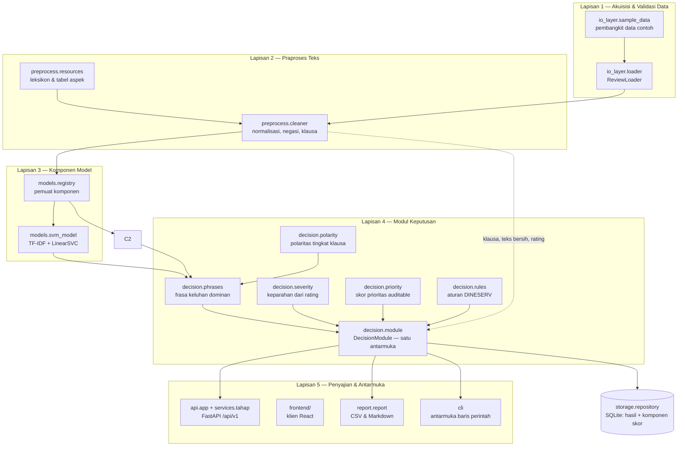
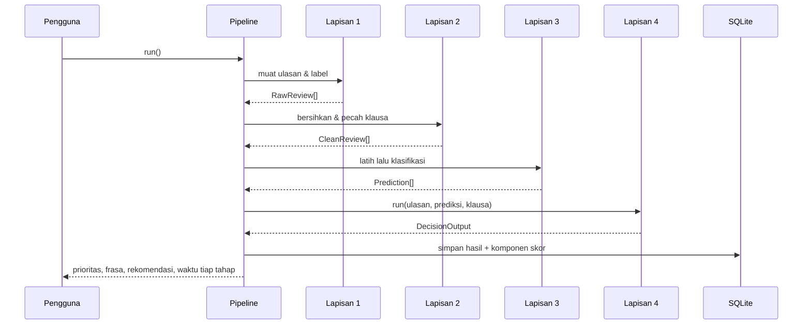

# Arsitektur Sistem Berlapis

Dokumen ini menjelaskan pembagian lapisan, kontrak antar-lapisan, dan alasan
di balik tiap keputusan perancangan. Inilah sisi **Software Engineering** dari
penelitian: yang dinilai bukan ketepatan model, melainkan apakah sistemnya
tersusun sebagai komponen yang dapat diganti dan dipertanggungjawabkan.

## 1. Gambaran menyeluruh



Berkas pendukung: `pipeline.py` merangkai L1–L4 (`Pipeline.run`), `config.py`
memuat konfigurasi, `contracts.py` menetapkan bentuk data antar-lapisan,
`evaluate.py` menjadi satu-satunya sumber angka kinerja.

## 2. Peran dan kontrak tiap lapisan

### Lapisan 1 — Akuisisi & Validasi Data

| Aspek | Keterangan |
|---|---|
| Berkas | `io_layer/loader.py`, `io_layer/sample_data.py` |
| Masukan | berkas CSV/JSONL ulasan: `review_id, text, rating, date, restaurant` |
| Keluaran | `tuple[RawReview, ...]` |
| Kontrak | setiap ulasan punya identitas unik dan teks tidak kosong; rating opsional |
| Alasan | memisahkan **bentuk berkas** dari **isi**. Mengganti sumber data (ekspor Google Maps, basis data, API) cukup menambah pemuat baru; lapisan lain tidak perlu tahu. |

### Lapisan 2 — Praproses Teks

| Aspek | Keterangan |
|---|---|
| Berkas | `preprocess/cleaner.py`, `preprocess/resources.py` |
| Masukan | `RawReview` |
| Keluaran | `CleanReview` (memuat `text_clean` **dan** `clauses`) |
| Kontrak | praproses bersifat **surjektif terhadap makna**: tidak menghapus kata yang membawa polaritas maupun penanda tingkat |
| Alasan | ABSA bekerja pada rentang teks. Menghapus kata sifat penilai ("hambar", "lambat", "kotor") akan menghilangkan justru isi keluhan yang paling berharga. |

Pemrosesan dilakukan sepuluh tahap, dan tiap tahap dapat ditelusuri lewat
`Cleaner.trace()` — berguna ketika pembimbing menanyakan "mengapa teks ini
menjadi seperti itu".

Tahap kunci:

1. normalisasi unicode & huruf kecil;
2. pemetaan singkatan & bahasa gaul (`gk` → `tidak`, `bgt` → `banget`, …);
3. pembuangan tautan, mention, tanda baca berulang;
4. penanganan negasi — cakupan kata "tidak" berhenti pada **batas klausa**
   (dan/tapi/namun/sedangkan/…), bukan menyapu seluruh kalimat;
5. pemecahan menjadi klausa (`clauses`) sebagai satuan analisis polaritas.

### Lapisan 3 — Komponen Model (dapat diganti)

| Aspek | Keterangan |
|---|---|
| Berkas | `models/base.py`, `models/sklearn_base.py`, `models/svm_model.py`, `models/registry.py` |
| Masukan | `TrainingExample` |
| Keluaran | `Prediction` per ulasan (multilabel aspek + sentimen per aspek) |
| Kontrak | kelas dasar `AspectSentimentModel` menetapkan `fit`, `predict`, `predict_with_ids`, `name`, `display_name`, `description` |
| Alasan | memisahkan algoritma dari lapis lain lewat kontrak `AspectSentimentModel`, sehingga lapis keputusan dan antarmuka tidak bergantung pada rincian SVM. Penelitian memakai satu komponen: TF-IDF + SVM linear. |

Komponen dialamatkan lewat nama pada konfigurasi (`model.name: svm`), bukan
lewat impor langsung di kode pemanggil. Parameter SVM disimpan di
`config/model_svm.yaml`.

Penanganan skor: `sklearn_base._class_scores` menyeragamkan keluaran
`predict_proba` dan `decision_function` menjadi matriks *(jumlah data ×
jumlah kelas)*, sehingga `argmax` selalu memilih di antara seluruh kelas yang
benar-benar dipelajari estimator. Sebelum perbaikan ini, klasifikasi sentimen
biner hanya menghasilkan satu skor dan `argmax` selalu memilih kelas pertama —
akurasi jatuh ke sekitar 0,35. Bug ini menjadi studi kasus pada Bab IV.

### Lapisan 4 — Modul Keputusan

| Aspek | Keterangan |
|---|---|
| Berkas | `decision/module.py` (antarmuka tunggal), `decision/phrases.py`, `decision/polarity.py`, `decision/severity.py`, `decision/priority.py`, `decision/rules.py` |
| Masukan | ulasan bersih + `Prediction` |
| Keluaran | `DecisionOutput`: `priorities`, `phrases`, `recommendations`, `stats`, `weights` |
| Kontrak | `DecisionModule.run(reviews, predictions, *, clean_text, clauses, model_name)` adalah **satu-satunya** pintu masuk lapisan ini |
| Alasan | memisahkan **klasifikasi** dari **keputusan**. Cara sistem menetapkan prioritas tidak bergantung pada rincian algoritma klasifikasi. |

Empat komponen keputusan:

**a. Keparahan — `severity.py`**

```
Keparahan(u) = (5 − rating(u)) / (5 − 1)
```

Bintang 1 → 1,0; bintang 5 → 0,0. Bila rating tidak ada, dipakai nilai bawaan
0,5. Diturunkan dari rating, **bukan** dari model sentimen, agar kesalahan
model tidak merambat ke skor prioritas tanpa kendali.

**b. Frasa keluhan dominan — `phrases.py`**

Alur: klausa per aspek → calon frasa (n-gram yang **tidak** melintasi batas
klausa) → saringan frasa → pembobotan TF-IDF → peringkat.

Penyaringan berlapis: klausa harus memuat (1) kata penanda aspek **dan**
indikasi keluhan, atau (2) hanya kata penanda aspek; bila keduanya tidak
terpenuhi barulah seluruh klausa ulasan dipakai sebagai jaring pengaman.
Frasa satu kata yang hanya mengulang kata penanda aspek dibuang, karena
"harga" pada aspek harga tidak memberi informasi apa pun.

Pencocokan kata penanda aspek dilakukan **per kata**, bukan substring, dengan
akhiran yang diizinkan terbatas (`-nya, -ku, -mu, -lah, -kah`). Alasannya
konkret: pencocokan substring membuat kata `menu` cocok dengan `menunggu`,
sehingga keluhan pelayanan masuk ke daftar aspek makanan.

Penamaan yang dipakai adalah **"frasa keluhan dominan"**, bukan "akar
masalah". Frekuensi menunjukkan sesuatu yang menonjol, bukan hubungan sebab
akibat — dan sistem tidak boleh mengklaim lebih dari yang dapat dibuktikan.

**c. Skor prioritas — `priority.py`**

```
Prioritas(a) = w₁ · Volume(a) + w₂ · Keparahan(a) + w₃ · Keragaman(a)
```

| Komponen | Definisi | Rentang |
|---|---|---|
| Volume | proporsi keluhan aspek terhadap seluruh keluhan | dinormalisasi min–maks ke [0, 1] |
| Keparahan | rata-rata keparahan ulasan negatif pada aspek itu | sudah [0, 1] secara alami |
| Keragaman | banyaknya frasa keluhan berbeda, dinormalisasi | dinormalisasi min–maks ke [0, 1] |

Bobot bawaan `w₁ = 0,4`, `w₂ = 0,4`, `w₃ = 0,2`, dengan syarat
`w₁ + w₂ + w₃ = 1`. Hanya Volume dan Keragaman yang dinormalisasi karena
Keparahan sudah berskala [0, 1] sejak didefinisikan — menormalkannya kembali
justru akan mengubah maknanya. Bobot dapat diganti lewat konfigurasi, dan
setiap komponen skor disimpan ke basis data sehingga **setiap peringkat dapat
ditelusuri sampai angka penyusunnya**. Inilah yang membuat klaim
"prescriptive, bukan sekadar deskriptif" dapat dipertahankan.

Pengurutan bersifat deterministik: `(-prioritas, -n_negatif, aspek)`, sehingga
dua jalan dengan data sama selalu memberi urutan yang sama.

**d. Aturan rekomendasi — `rules.py`**

Tabel aturan per aspek DINESERV yang memetakan frasa keluhan teratas menjadi
tindakan yang disarankan, dengan satu aturan cadangan (`FALLBACK`) bila tidak
ada pola yang cocok. Sengaja berupa pengetahuan domain, bukan keluaran model:
rekomendasi tindakan harus dapat dipertanggungjawabkan oleh manusia.

### Lapisan 5 — Penyajian & Antarmuka

| Aspek | Keterangan |
|---|---|
| Berkas | 5a: `api/app.py`, `api/schemas.py`, `services/tahap.py`, `cli.py`, `report/report.py` · 5b: `frontend/src` |
| Peran | **lapisan tipis** — 5a membaca bukti tiap tahap (basis data, `reports/`, `config/`) dan menyajikannya sebagai JSON; 5b hanya menampilkan JSON itu |
| Kontrak | tidak ada logika keputusan di lapisan ini |
| Alasan | bila ada logika bisnis di sini, angka di layar dapat menyimpang dari arsip; seluruh angka dibaca dari basis data. |

Antarmuka menampilkan skor prioritas pada skala 0–100 (skor tersimpan 0–1
dikalikan 100 saat tampil) dan tidak menyediakan pemilih model. Respons
`/api/v1/hasil` memakai dataclass `AspectPriority` dari `contracts.py` sebagai
model respons, sehingga skema OpenAPI (`docs/openapi.json`) tidak dapat
menyimpang dari kontrak. Bila bukti suatu tahap belum ada, API menjawab
`status: belum_tersedia` beserta perintah pembuatnya; angka tidak pernah
diperkirakan. Klien dibundel penuh (tanpa CDN) sehingga KNF-02 terpenuhi.

## 3. Mengapa lima lapisan, bukan satu skrip

| Keuntungan | Wujud nyata di repositori |
|---|---|
| Kontrak tetap | objek antar-lapis didefinisikan di `contracts.py` dan didokumentasikan di `docs/KONTRAK.md` |
| Keputusan dapat diaudit | komponen skor prioritas tersimpan per jalan di SQLite |
| Kesalahan terlokalisasi | bug skor sentimen hanya menyentuh `models/sklearn_base.py` |
| Dapat diuji per lapisan | dua belas berkas uji: unit, integrasi, dan sistem (kotak hitam CLI, halaman) |
| Dapat dilaporkan tanpa menyebut algoritma | angka Bab IV berasal dari `evaluate.py`, terpisah dari model |

## 4. Aliran data antar-lapisan



## 5. Berkas konfigurasi

Seluruh jalur dan parameter berada di `config/default.yaml`; tidak ada nilai
yang ditulis di dalam kode.

```yaml
project:  { name, seed }
paths:    { raw, reference, processed, reports, artifacts, reviews_file, labels_file, db_path }
model:    { name, text: {max_features, ngram_range, min_df}, svm: {...} }
aspect_labels: {...}
decision: { weights: {volume, severity, diversity} }
evaluation: { folds, top_k, test_size }
```

Penimpaan berlapis, dari yang paling umum ke paling khusus:

```bash
python -m rra.cli run --config config/default.yaml \
                      --override config/model_svm.yaml \
                      --set decision.weights.volume=0.5
```

Konfigurasi yang dipakai **disimpan bersama setiap hasil**, sehingga suatu
angka dapat direproduksi persis walau nilai bawaannya kemudian berubah.
